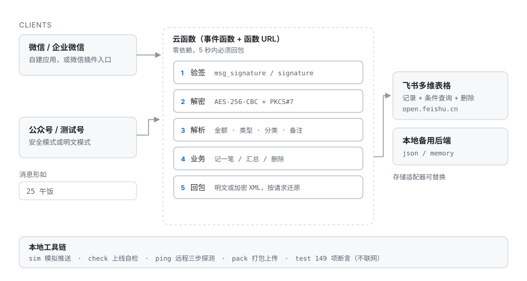

# 碎银 Suiyin

在微信里发一句 `25 午饭`，自动记一笔并回执；数据写进飞书多维表格，随时用 `本月`、`明细` 查，用 `删1` 撤销。

> 每周一个 vibecoding 实践项目 · 第 1 期

*名字取自「世人慌慌张张，不过图碎银几两」——记的就是这些碎银。*

运行时零依赖：14 个文件、约 29 KB 的压缩包，直接上传成云函数即可，不需要 `npm install`，也不需要数据库。



## 特性

| 能力 | 说明 |
|---|---|
| 一句话记账 | 金额位置任意、量词自动跳过（`奶茶 18 2杯`）、收入按关键词判定（`+3000 工资`）、分类自动归类 |
| 查询与撤销 | 本月汇总（含分类占比）、今日、昨天、最近 10 条、删最近 N 条 |
| 双通道共存 | 企业微信自建应用 + 微信公众号（含测试号），靠签名自动分流，同一份代码同时服务两边 |
| 存储可替换 | 飞书多维表格 / 本地 JSON / 内存，接口一致，改一个环境变量即可切换 |
| 针对 5 秒窗口设计 | 预算控制、逐级降级、消息幂等，详见[工程说明](#工程说明) |
| 自诊断 | 发 `诊断` 直接在聊天窗口看到通道、地域、凭证与查询各自的耗时 |

## 消息语法

| 发送 | 效果 |
|---|---|
| `25 午饭` | 支出 ¥25，备注「午饭」，分类「餐饮」 |
| `午饭 25` / `-25 午饭` | 同上，金额位置随意 |
| `+3000 工资` | 收入 ¥3000 |
| `25 奶茶 #餐饮` / `25 奶茶 分类=餐饮` | 指定分类 |
| `本月` / `统计` | 本月汇总 + 分类占比 |
| `今天` / `今日` / `昨天` | 当日明细 |
| `明细` / `记录` / `最近` | 最近 10 条 |
| `删1` / `撤销` / `删2` | 删掉最近第 1 条（或第 N 条） |
| `去重` | 把 3 分钟内完全相同的记录并成一条 |
| `诊断` | 通道、存储、地域与耗时 |
| `帮助` | 用法 |

## 快速开始

### 1. 本地跑通（不需要任何账号）

```bash
git clone https://github.com/Karasus404/suiyin.git
cd suiyin
npm test                 # 149 项断言，不联网、不需要凭证
```

用内存后端起一个本地服务，再用模拟器发一条消息，验证往返：

```bash
# 终端 1
cp .env.example .env
# 把 APP_STORE 改成 memory，WECOM_* 填任意测试值
node src/local-server.js          # 监听 3000

# 终端 2
node tools/sim.js --plain "25 午饭"
```

`--plain` 走明文模式；去掉它则按企业微信的加密格式发送。Windows 上也可以直接双击 `check.cmd`、`pack.cmd`。

### 2. 准备凭证

三样东西，缺一不可：

| 来源 | 需要的值 |
|---|---|
| 飞书多维表格 | `App ID`、`App Secret`、`App Token`、`Table ID` |
| 企业微信（或公众号） | `CorpID`（AppID）、`Token`、`EncodingAESKey` |

> 飞书**个人版账号无法调用开放接口**（报 `21001 Access denied due to platform policy`），
> 需要先创建或加入一个企业团队，再在该团队下建应用。

把它们写进 `.env`：

```bash
node tools/setenv.js --paste     # 粘一整段，自动校验格式并备份旧文件
node tools/setenv.js --show      # 打码查看当前配置
```

也可以参照 `.env.example` 手工填写。

### 3. 部署

```bash
node tools/pack.js              # 生成 dist/suiyin.zip
node tools/check.js             # 上线前 8 项自检
```

云函数侧的关键配置（腾讯云 SCF）：

- 函数类型 **事件函数**（Web 函数要求 `scf_bootstrap`，本包没有）
- 代码入口 `index.js`，执行方法 `main`，运行环境 Node.js 18+
- HTTP 入口用 **函数 URL**（API 网关已于 2025-06-30 停止新建触发器），
  公网访问开启、授权类型「开放」；返回值 `{statusCode, headers, body}` 会被原生解析，无需集成响应
- 超时时间改成 **10 秒**，内存 256 MB（默认 3 秒会在写完飞书后被强制中断：飞书有记录、微信没回信）
- 日志配置选「默认投递」，否则控制台看不到调用日志

部署后用 `tools/ping.js` 三步探测整条链路：

```bash
node tools/ping.js https://<your-function-url>
# 1 裸 GET       → 地址通不通、公网访问开没开
# 2 带签名 GET   → Token / AESKey / CorpID 对不对
# 3 加密 POST    → 完整往返，并把平台会收到的回复解密打印
```

界面级操作见 [`DEPLOY.html`](DEPLOY.html)（企业微信）与 [`WECHAT.html`](WECHAT.html)（公众号 / 测试号）。

## 配置项

### 通道（至少配置一套）

| 变量 | 说明 |
|---|---|
| `WECOM_CORP_ID` `WECOM_TOKEN` `WECOM_AES_KEY` | 企业微信通道，三个都要 |
| `WECHAT_APP_ID` `WECHAT_TOKEN` | 公众号 / 测试号通道，两个都要 |
| `WECHAT_AES_KEY` | 安全模式填 43 位；明文模式留空 |
| `WECHAT_MODE` | 默认 `auto`，按请求特征判断加密方式 |

两套凭证可以同时存在。程序用「签名能否校验通过」判断消息属于哪个通道，再按该通道的方式回包：
企业微信必须加密；公众号则取决于**这条请求本身**是否加密（明文模式下即使配了 AESKey，回包也必须是明文）。

### 行为

| 变量 | 默认 | 说明 |
|---|---|---|
| `APP_STORE` | `feishu` | `feishu` / `json` / `memory` |
| `APP_TZ_OFFSET` | `8` | 时区，用于「今天 / 本月」 |
| `APP_SHOW_TODAY_TOTAL` | `1` | 回执是否带今日 / 本月合计（多一次查询），设 `0` 更快 |
| `APP_STATS_BUDGET_MS` | `1500` | 合计这一行的独立预算，拿不到就省略该行，不影响记账成功 |
| `APP_DEDUPE_CHECK` | `1` | 记账后复用同一次查询检查「90 秒内一模一样的记录」，发现就在回执里提示 |
| `APP_FEISHU_TIMEOUT_MS` | `3800` | 单次飞书请求上限，超时降级 |
| `FEISHU_FIELD_*` | 金额 / 类型 / 备注 / 分类 / 日期 | 表里列名不同时改这里 |
| `FEISHU_TYPE_EXPENSE` / `_INCOME` | 支出 / 收入 | 单选字段的选项值 |

## 工程说明

微信与企业微信都要求 **5 秒内**响应，否则重投同一条消息（最多 3 次）。这套代码的很多设计都由这条约束推导而来。

**只做被动回复，不主动发消息。** 企业微信主动推送需要配置「可信 IP」，而云函数的出口 IP 不固定。
被动回复只要在响应体里直接返回 XML 即可，因此只需要 `Token` / `AESKey` / `CorpID`，不需要 `corpsecret`。

**回执不等统计。** 记账先落库，落库成功即组装回执；「今日合计」用独立预算计算，超时就整行省略。
代价是偶尔少一行汇总，收益是绝不因为多一行统计而超时。

**消息幂等。** 平台重投时 `MsgId` 不变，命中缓存就直接重发上次的回执。
没有这层保护，一次超时会记成两笔账，或把 `删1` 执行两次。

这层缓存只在**同一个函数实例**里有效。重投如果落到另一个实例（冷启动新实例、
或平台把两次投递分到不同实例），它挡不住。本想把幂等下沉到写入层，但飞书多维表格的
新增记录接口**并不做幂等**——`client_token` 无论是放 query 还是放 body（单条 / `batch_create`
都试过），同一个 token 连发两次照样落两条记录*（实测，2026-11）。

所以重复只能靠两层兜底：

1. **记账后自检**：算「今日合计」的那次查询顺带看一眼同金额、同备注、90 秒内的记录，
   命中就在回执末尾提示一句，不额外花时间。
2. **`去重` 命令**：主动清理最近 200 条里 3 分钟内完全相同的记录，每组留最早那条。
   类型、金额、备注三者都相同才算重复，一收一支不算，隔了几小时的相同开销也不算。

**按剩余预算收紧单次请求。** 单次飞书请求的上限取 `min(配置上限, 剩余预算 - 350ms)`，
而不是一律等满配置值——链路慢时早点放弃，至少还能回一句有用的话。

**加密算法两个平台一致。** 都是 AES-256-CBC + PKCS#7，差异只有三处：验签参数名
（`msg_signature` 对比明文 `signature`）、receiveid（企业微信是 `CorpID`，公众号是 `AppID`）、
是否强制加密。所以同一套 `src/wxcrypt.js` 可以服务两条通道。

**飞书的两个坑。** 日期筛选不支持 `isGreaterEqual`，`>= from` 要用 `isGreater(from - 1)` 表达；
同一毫秒的多条记录排序不稳定，需要用写入顺序做次级键，否则「删最近一条」会删错。

**冷启动的真实成本。** 实例会被复用，`tenant_access_token` 缓存在进程内（有效期 2 小时）。
闲置后第一条消息要重新取 token（约 1.2 秒）再查一次数据（约 1.3 秒），合计约 2.5 秒；
预热后每条约 1.3 秒。两者都在 5 秒窗口内，不值得为此上「预置并发」。

## 排错

先发一句 `诊断`，它把耗时拆开，避免瞎猜：

```
🩺 诊断
通道 企业微信 · 存储 feishu · 地域 ap-guangzhou
取 token 1178ms（重新获取）
读一条记录 1302ms
本实例 冷启动（首条消息容易慢）
剩余预算 1717ms
回包上限 4500ms · 飞书单请求 3800ms
```

| 症状 | 判断 |
|---|---|
| 明细 / 本月全是 `¥0.00`，或回「读到了 N 条记录，但字段值全是空的」 | **飞书高级权限**：应用只有「可编辑」不够，要「可管理」。多维表格右上角 `···` → `···更多` → `添加文档应用` → 选应用 → 权限选「可管理」 |
| 「取 token」慢（> 800ms） | 冷启动，或到飞书的网络 RTT 高 |
| 「取 token」快、「读一条记录」慢（> 1500ms） | 飞书接口本身慢，或表数据量变大 |
| 飞书里有记录、微信没回信 | 云函数超时时间太小（默认 3 秒），改成 10 秒 |
| 同一笔账出现两条 | 旧版本没有幂等；升级到 v1.4，或直接发 `去重` |
| 保存回调 URL 提示失败 | 公网访问没开，或授权类型选成了鉴权 |
| 收到 401 / `解密失败` | `Token` 或 `AESKey` 与后台不一致 |
| `receiveid 不匹配` | `WECOM_CORP_ID` 填错，或公众号 `AppID` 与加密时用的不一致 |

更多界面级排查见 `DEPLOY.html` 的「排错」一节。

## 目录

```
index.js              云函数入口，exports.main 把事件交给 handler
src/config.js         环境变量 → 配置对象，含完整性校验
src/wxcrypt.js        AES-256-CBC 加解密、签名、XML 组包与取值
src/parse.js          一句话 → { 金额, 类型, 分类, 备注 } 或指令
src/ledger.js         业务编排与回执文案，预算控制在这里
src/handler.js        通道匹配、验签解密、幂等缓存、回包
src/dedupe.js         进程内 MsgId 去重键
src/normalize.js      腾讯云 SCF / CloudBase / 阿里云 FC 事件归一化
src/store/feishu.js   飞书多维表格读写（token 缓存、超时降级）
src/store/local.js    json / memory 后端
src/local-server.js   本地调试用 HTTP 服务
src/dotenv.js         无依赖的 .env 解析
tools/                sim 模拟推送 · check 上线自检 · ping 远程探测 · pack 打包 · setenv 写配置
test/run.js           149 项断言，覆盖加解密、解析、业务、回调、存储契约
assets/               架构图
DEPLOY.html           企业微信部署手册（界面级步骤）
WECHAT.html           公众号 / 测试号接入手册
```

## 测试

```bash
npm test
```

覆盖加解密往返与签名、平台事件格式归一化、解析规则、记账 / 查询 / 删除、回执文案、
飞书请求契约（用假 `fetch` 断言 URL、请求体与字段映射，不联网）、慢存储与超时防护、
重复消息去重。CI 在 Node.js 18 / 20 / 22 上跑同一套，并检查打包产物里不含 `.env`。

## 已知限制

- 只处理文本消息，图片与语音直接提示用法。
- 不区分发送者：所有消息进同一本账（单用户场景）。多人共用需自行增加 `FromUserName` 维度。
- 依赖平台 5 秒窗口，链路过慢时回执会降级为「这次有点慢，命令可能已经执行了」。
- 飞书开放接口有频率限制；个人版账号不可用（见上文）。
- 解析规则针对中文习惯，`#分类` 与关键词表写在 `src/parse.js` 顶部，改动是纯数据。

## License

[MIT](LICENSE)
